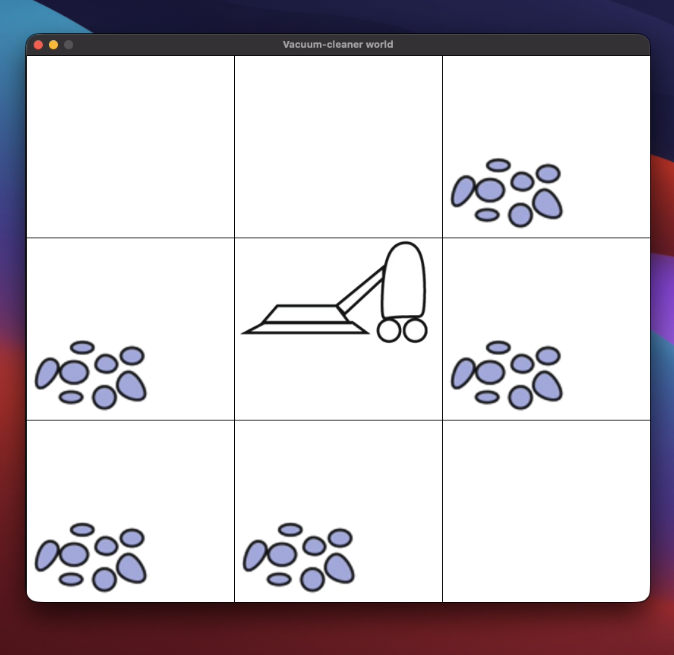

# Analysing different agent performance in vaccum world

## Environment setup

Run following commands in order:
1. `conda env create -f environment.yml`
2. `conda activate ai`

You can modify different agents and environment in `vc_ui.py` file.
To run the code run `python vc_ui.py` 

## 1. BFS (`bfs_agent.py`)

Searches nearby states first, so it finds shortest plan.

1. Put the starting state in a queue.
2. Take oldest state from queue.
3. If it is a goal, return its plan.
4. Add each new state and its plan to the end of the queue.
5. Repeat until a goal is found or there are no states left.

## 2. DFS (`dfs_agent.py`)

Follows one path as far as possible before trying another. It may find a longer plan.

1. Put the starting state in a stack.
2. Take newest state from stack.
3. If it is a goal, return its plan.
4. Add unvisited next states and their plans to the stack.
5. Repeat until a goal is found or there are no states left.

## 3. Greedy BFS (`greedy_bfs_agent.py`)

This implementation uses a stack (like DFS), but orders moves using a heuristic: a score that estimates how much work remains. Here, each dirty room adds 2 points, and being in a dirty room subtracts 1 because it can be cleaned right away. Lower scores look more promising.

1. Put the starting state in a stack.
2. Take newest state from stack.
3. If it is a goal, return its plan.
4. Sort next moves by heuristic score, then explore lowest-scoring move first.
5. Repeat until a goal is found or there are no states left.

## 4. IDDFS (`iddfs_agent.py`)

Runs depth-limited DFS again and again, increasing the limit each time.

1. Start with a depth limit of zero.
2. Search from start, but do not go past imit.
3. If a goal is found, return its plan.
4. If deeper states remain to explore, increase the limit and search again.

## 5. A* (`a_agent.py`)

Chooses the state with the lowest estimated total cost: cost so far (`g`) plus estimated cost remaining (`h`).

1. Put the starting state in a priority queue, ordered by `g + h`.
2. Take out the state with the lowest score.
3. If it is a goal, return its plan.
4. Add or update next states when a cheaper path is found.
5. Repeat until a goal is found or the queue is empty.

## Performance

Energies spent for same environment (`3 x 3`, dirt rate `0.6`, seed `73`):

| Agent | Energy Spent |
| --- | ---: |
| BFS | 12 |
| DFS | 17 |
| IDDFS | 12 |
| Greedy BFS | 13 |
| A* | 12 |

These are the energy spent by each agent, not runtime measurements.

Link to view repository to track changes made after submission: [GitHub repository](https://github.com/VighneshManjrekar/vaccum-world-agents.git).

This project builds on starter code provided by Prof. Schwede. The search agents were implemented as extensions to that code.
